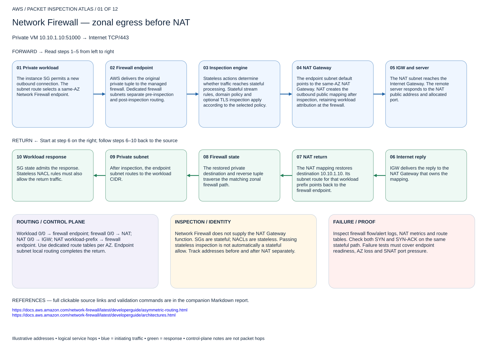

# Network Firewall — zonal egress before NAT

## 01. Network Firewall — zonal egress before NAT

Private VM 10.10.1.10:51000 → Internet TCP/443

### Forward packet walk

1. **Private workload.** The instance SG permits a new outbound connection. The subnet route selects a same-AZ Network Firewall endpoint.
2. **Firewall endpoint.** AWS delivers the original private tuple to the managed firewall. Dedicated firewall subnets separate pre-inspection and post-inspection routing.
3. **Inspection engine.** Stateless actions determine whether traffic reaches stateful processing. Stateful stream rules, domain policy and optional TLS inspection apply according to the selected policy.
4. **NAT Gateway.** The endpoint subnet default points to the same-AZ NAT Gateway. NAT creates the outbound public mapping after inspection, retaining workload attribution at the firewall.
5. **IGW and server.** The NAT subnet reaches the Internet Gateway. The remote server responds to the NAT public address and allocated port.

### Return packet walk

6. **Internet reply.** IGW delivers the reply to the NAT Gateway that owns the mapping.
7. **NAT return.** The NAT mapping restores destination 10.10.1.10. Its subnet route for that workload prefix points back to the firewall endpoint.
8. **Firewall state.** The restored private destination and reverse tuple traverse the matching zonal firewall path.
9. **Private subnet.** After inspection, the endpoint subnet routes to the workload CIDR.
10. **Workload response.** SG state admits the response. Stateless NACL rules must also allow the return traffic.

### Routing and control plane

Workload 0/0 → firewall endpoint; firewall 0/0 → NAT; NAT 0/0 → IGW; NAT workload-prefix → firewall endpoint. Use dedicated route tables per AZ. Endpoint subnet local routing completes the return.

### Inspection and identity

Network Firewall does not supply the NAT Gateway function. SGs are stateful; NACLs are stateless. Passing stateless inspection is not automatically a stateful allow. Track addresses before and after NAT separately.

### Failure and validation

Inspect firewall flow/alert logs, NAT metrics and route tables. Check both SYN and SYN-ACK on the same stateful path. Failure tests must cover endpoint readiness, AZ loss and SNAT port pressure.

Sources: [Reference 1](https://docs.aws.amazon.com/network-firewall/latest/developerguide/asymmetric-routing.html) · [Reference 2](https://docs.aws.amazon.com/network-firewall/latest/developerguide/architectures.html)

## Terraform lab

[Open this scenario lab](2026-11-04-0203-terraform/native-egress/README.md). Self-contained one-AZ lab: VPC, three subnets, Network Firewall, NAT Gateway, IGW, route tables, logs and an SSM-managed private EC2 instance. This reduces cost but does not test multi-AZ HA.

Use aws ssm start-session --target INSTANCE_ID. Run curl -I https://www.example.com and curl -I http://www.example.com; these are allowed TCP/443 and TCP/80 tests. A fresh TCP/81 connection must fail. Check flow/alert logs and public egress IP. No domain allowlist is configured.

[Editable multipage draw.io, page 01](2026-11-04-0203-aws-packet-inspection-atlas.drawio) · [All designs](README.md)
