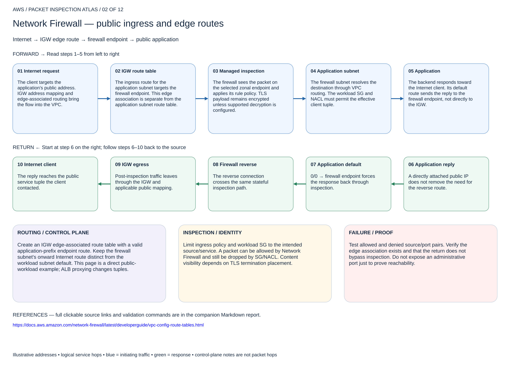

# Network Firewall — public ingress and edge routes

## 02. Network Firewall — public ingress and edge routes

Internet → IGW edge route → firewall endpoint → public application

### Forward packet walk

1. **Internet request.** The client targets the application's public address. IGW address mapping and edge-associated routing bring the flow into the VPC.
2. **IGW route table.** The ingress route for the application subnet targets the firewall endpoint. This edge association is separate from the application subnet route table.
3. **Managed inspection.** The firewall sees the packet on the selected zonal endpoint and applies its rule policy. TLS payload remains encrypted unless supported decryption is configured.
4. **Application subnet.** The firewall subnet resolves the destination through VPC routing. The workload SG and NACL must permit the effective client tuple.
5. **Application.** The backend responds toward the Internet client. Its default route sends the reply to the firewall endpoint, not directly to the IGW.

### Return packet walk

6. **Application reply.** A directly attached public IP does not remove the need for the reverse route.
7. **Application default.** 0/0 → firewall endpoint forces the response back through inspection.
8. **Firewall reverse.** The reverse connection crosses the same stateful inspection path.
9. **IGW egress.** Post-inspection traffic leaves through the IGW and applicable public mapping.
10. **Internet client.** The reply reaches the public service tuple the client contacted.

### Routing and control plane

Create an IGW edge-associated route table with a valid application-prefix endpoint route. Keep the firewall subnet's onward Internet route distinct from the workload subnet default. This page is a direct public-workload example; ALB proxying changes tuples.

### Inspection and identity

Limit ingress policy and workload SG to the intended source/service. A packet can be allowed by Network Firewall and still be dropped by SG/NACL. Content visibility depends on TLS termination placement.

### Failure and validation

Test allowed and denied source/port pairs. Verify the edge association exists and that the return does not bypass inspection. Do not expose an administrative port just to prove reachability.

Sources: [Reference 1](https://docs.aws.amazon.com/network-firewall/latest/developerguide/vpc-config-route-tables.html)

## Terraform lab

[Open this scenario lab](2026-11-04-0203-terraform/endpoint-routes/README.md). Integration lab for a dedicated existing VPC/IGW, public test workload, ready Network Firewall or GWLBE endpoint, dedicated edge and workload route tables. Creates endpoint routes and optional IGW edge association. It does not create an Internet-facing application.

Set the edge application-subnet route to the endpoint and the application default to the same stateful endpoint. Ensure endpoint-subnet onward route reaches IGW. Test the public service from an allowed and denied client and correlate both directions.

[Editable multipage draw.io, page 02](2026-11-04-0203-aws-packet-inspection-atlas.drawio) · [All designs](README.md)
