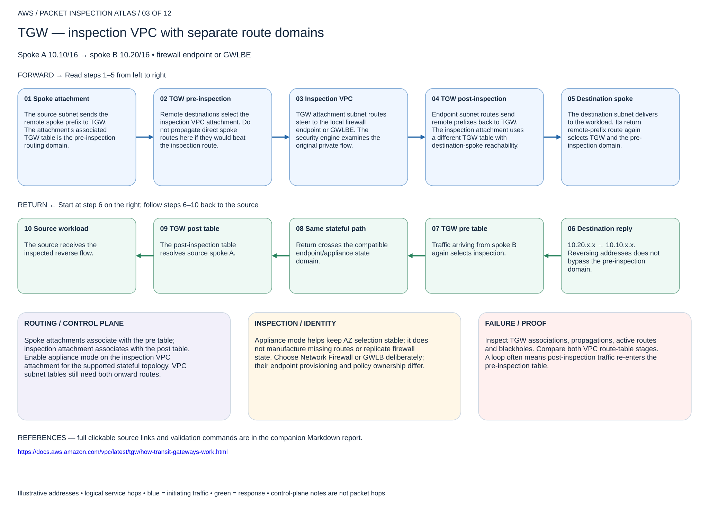

# TGW — inspection VPC with separate route domains

## 03. TGW — inspection VPC with separate route domains

Spoke A 10.10/16 → spoke B 10.20/16 • firewall endpoint or GWLBE

### Forward packet walk

1. **Spoke attachment.** The source subnet sends the remote spoke prefix to TGW. The attachment's associated TGW table is the pre-inspection routing domain.
2. **TGW pre-inspection.** Remote destinations select the inspection VPC attachment. Do not propagate direct spoke routes here if they would beat the inspection route.
3. **Inspection VPC.** TGW attachment subnet routes steer to the local firewall endpoint or GWLBE. The security engine examines the original private flow.
4. **TGW post-inspection.** Endpoint subnet routes send remote prefixes back to TGW. The inspection attachment uses a different TGW table with destination-spoke reachability.
5. **Destination spoke.** The destination subnet delivers to the workload. Its return remote-prefix route again selects TGW and the pre-inspection domain.

### Return packet walk

6. **Destination reply.** 10.20.x.x → 10.10.x.x. Reversing addresses does not bypass the pre-inspection domain.
7. **TGW pre table.** Traffic arriving from spoke B again selects inspection.
8. **Same stateful path.** Return crosses the compatible endpoint/appliance state domain.
9. **TGW post table.** The post-inspection table resolves source spoke A.
10. **Source workload.** The source receives the inspected reverse flow.

### Routing and control plane

Spoke attachments associate with the pre table; inspection attachment associates with the post table. Enable appliance mode on the inspection VPC attachment for the supported stateful topology. VPC subnet tables still need both onward routes.

### Inspection and identity

Appliance mode helps keep AZ selection stable; it does not manufacture missing routes or replicate firewall state. Choose Network Firewall or GWLB deliberately; their endpoint provisioning and policy ownership differ.

### Failure and validation

Inspect TGW associations, propagations, active routes and blackholes. Compare both VPC route-table stages. A loop often means post-inspection traffic re-enters the pre-inspection table.

Sources: [Reference 1](https://docs.aws.amazon.com/vpc/latest/tgw/how-transit-gateways-work.html)

## Terraform lab

[Open this scenario lab](2026-11-04-0203-terraform/tgw-domains/README.md). Creates pre/post TGW route tables, associations and inspection/delivery routes around existing dedicated attachments. Inspection VPC must already contain a ready Network Firewall endpoint or GWLB tier; use endpoint-routes for its subnet steering. All source attachments must be unattached to another route table or managed/imported deliberately.

Enable appliance mode on the inspection VPC attachment through its owning Terraform configuration before testing. Disable bypassing default associations/propagations. Test A→B and B→A, then a deny and AZ/appliance failure. This root does not silently modify external attachments.

[Editable multipage draw.io, page 03](2026-11-04-0203-aws-packet-inspection-atlas.drawio) · [All designs](README.md)
