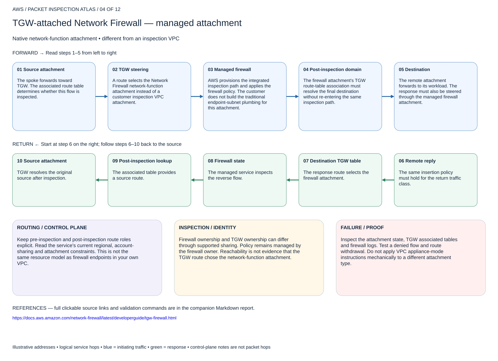

# TGW-attached Network Firewall — managed attachment

## 04. TGW-attached Network Firewall — managed attachment

Native network-function attachment • different from an inspection VPC

### Forward packet walk

1. **Source attachment.** The spoke forwards toward TGW. The associated route table determines whether this flow is inspected.
2. **TGW steering.** A route selects the Network Firewall network-function attachment instead of a customer inspection VPC attachment.
3. **Managed firewall.** AWS provisions the integrated inspection path and applies the firewall policy. The customer does not build the traditional endpoint-subnet plumbing for this attachment.
4. **Post-inspection domain.** The firewall attachment's TGW route-table association must resolve the final destination without re-entering the same inspection path.
5. **Destination.** The remote attachment forwards to its workload. The response must also be steered through the managed firewall attachment.

### Return packet walk

6. **Remote reply.** The same insertion policy must hold for the return traffic class.
7. **Destination TGW table.** The response route selects the firewall attachment.
8. **Firewall state.** The managed service inspects the reverse flow.
9. **Post-inspection lookup.** The associated table provides a source route.
10. **Source attachment.** TGW resolves the original source after inspection.

### Routing and control plane

Keep pre-inspection and post-inspection route roles explicit. Read the service's current regional, account-sharing and attachment constraints. This is not the same resource model as firewall endpoints in your own VPC.

### Inspection and identity

Firewall ownership and TGW ownership can differ through supported sharing. Policy remains managed by the firewall owner. Reachability is not evidence that the TGW route chose the network-function attachment.

### Failure and validation

Inspect the attachment state, TGW associated tables and firewall logs. Test a denied flow and route withdrawal. Do not apply VPC appliance-mode instructions mechanically to a different attachment type.

Sources: [Reference 1](https://docs.aws.amazon.com/network-firewall/latest/developerguide/tgw-firewall.html)

## Terraform lab

[Open this scenario lab](2026-11-04-0203-terraform/tgw-native-firewall/README.md). Creates the native TGW-attached Network Firewall using an existing TGW and policy ARN. Confirm region support and valid AZ IDs; shared-account designs need the service acceptance/permissions workflow. After creation, obtain the network-function attachment ID from firewall/TGW status and use tgw-domains for steering.

Verify the firewall attachment is available. Apply pre/post associations in the separate integration root, then test a private flow and a denial. Do not mix customer inspection-VPC subnet assumptions into this attachment model.

[Editable multipage draw.io, page 04](2026-11-04-0203-aws-packet-inspection-atlas.drawio) · [All designs](README.md)
