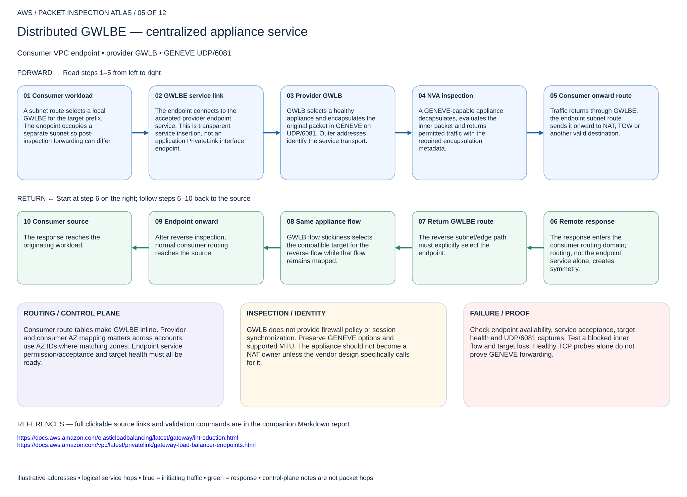

# Distributed GWLBE — centralized appliance service

## 05. Distributed GWLBE — centralized appliance service

Consumer VPC endpoint • provider GWLB • GENEVE UDP/6081

### Forward packet walk

1. **Consumer workload.** A subnet route selects a local GWLBE for the target prefix. The endpoint occupies a separate subnet so post-inspection forwarding can differ.
2. **GWLBE service link.** The endpoint connects to the accepted provider endpoint service. This is transparent service insertion, not an application PrivateLink interface endpoint.
3. **Provider GWLB.** GWLB selects a healthy appliance and encapsulates the original packet in GENEVE on UDP/6081. Outer addresses identify the service transport.
4. **NVA inspection.** A GENEVE-capable appliance decapsulates, evaluates the inner packet and returns permitted traffic with the required encapsulation metadata.
5. **Consumer onward route.** Traffic returns through GWLBE; the endpoint subnet route sends it onward to NAT, TGW or another valid destination.

### Return packet walk

6. **Remote response.** The response enters the consumer routing domain; routing, not the endpoint service alone, creates symmetry.
7. **Return GWLBE route.** The reverse subnet/edge path must explicitly select the endpoint.
8. **Same appliance flow.** GWLB flow stickiness selects the compatible target for the reverse flow while that flow remains mapped.
9. **Endpoint onward.** After reverse inspection, normal consumer routing reaches the source.
10. **Consumer source.** The response reaches the originating workload.

### Routing and control plane

Consumer route tables make GWLBE inline. Provider and consumer AZ mapping matters across accounts; use AZ IDs where matching zones. Endpoint service permission/acceptance and target health must all be ready.

### Inspection and identity

GWLB does not provide firewall policy or session synchronization. Preserve GENEVE options and supported MTU. The appliance should not become a NAT owner unless the vendor design specifically calls for it.

### Failure and validation

Check endpoint availability, service acceptance, target health and UDP/6081 captures. Test a blocked inner flow and target loss. Healthy TCP probes alone do not prove GENEVE forwarding.

Sources: [Reference 1](https://docs.aws.amazon.com/elasticloadbalancing/latest/gateway/introduction.html) · [Reference 2](https://docs.aws.amazon.com/vpc/latest/privatelink/gateway-load-balancer-endpoints.html)

## Terraform lab

[Open this scenario lab](2026-11-04-0203-terraform/gwlb-service/README.md). Creates GWLB, target group/listener, endpoint service and consumer endpoints around existing licensed GENEVE appliances and dedicated subnets. The supplied sample is same-account. Add endpoint-routes for both consumer directions.

The appliance must listen for GENEVE UDP/6081, preserve service metadata, pass configured health checks and implement vendor security. Verify healthy targets, accepted endpoint and both-direction inner-packet captures. Test a vendor deny and target loss.

[Editable multipage draw.io, page 05](2026-11-04-0203-aws-packet-inspection-atlas.drawio) · [All designs](README.md)
