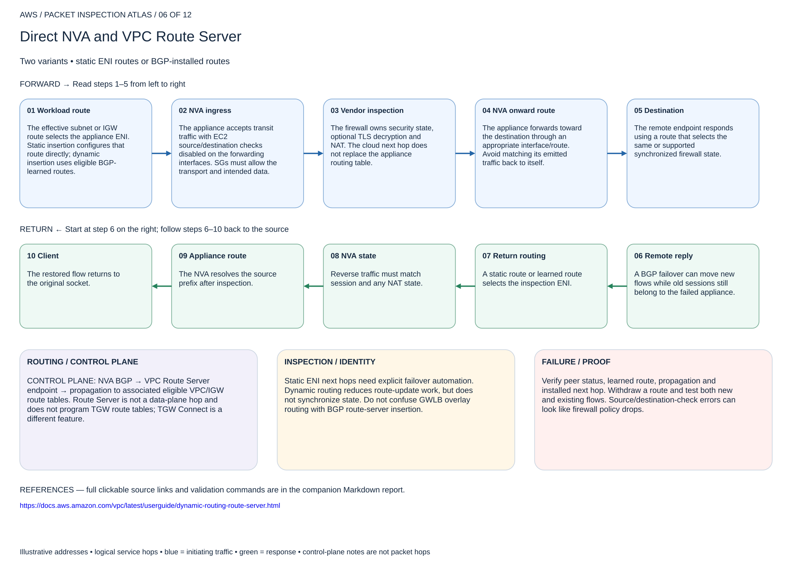

# Direct NVA and VPC Route Server

## 06. Direct NVA and VPC Route Server

Two variants • static ENI routes or BGP-installed routes

### Forward packet walk

1. **Workload route.** The effective subnet or IGW route selects the appliance ENI. Static insertion configures that route directly; dynamic insertion uses eligible BGP-learned routes.
2. **NVA ingress.** The appliance accepts transit traffic with EC2 source/destination checks disabled on the forwarding interfaces. SGs must allow the transport and intended data.
3. **Vendor inspection.** The firewall owns security state, optional TLS decryption and NAT. The cloud next hop does not replace the appliance routing table.
4. **NVA onward route.** The appliance forwards toward the destination through an appropriate interface/route. Avoid matching its emitted traffic back to itself.
5. **Destination.** The remote endpoint responds using a route that selects the same or supported synchronized firewall state.

### Return packet walk

6. **Remote reply.** A BGP failover can move new flows while old sessions still belong to the failed appliance.
7. **Return routing.** A static route or learned route selects the inspection ENI.
8. **NVA state.** Reverse traffic must match session and any NAT state.
9. **Appliance route.** The NVA resolves the source prefix after inspection.
10. **Client.** The restored flow returns to the original socket.

### Routing and control plane

CONTROL PLANE: NVA BGP → VPC Route Server endpoint → propagation to associated eligible VPC/IGW route tables. Route Server is not a data-plane hop and does not program TGW route tables; TGW Connect is a different feature.

### Inspection and identity

Static ENI next hops need explicit failover automation. Dynamic routing reduces route-update work, but does not synchronize state. Do not confuse GWLB overlay routing with BGP route-server insertion.

### Failure and validation

Verify peer status, learned route, propagation and installed next hop. Withdraw a route and test both new and existing flows. Source/destination-check errors can look like firewall policy drops.

Sources: [Reference 1](https://docs.aws.amazon.com/vpc/latest/userguide/dynamic-routing-route-server.html)

## Terraform lab

[Open this scenario lab](2026-11-04-0203-terraform/route-server/README.md). Creates VPC Route Server, endpoints, BGP peers and propagation into dedicated existing route tables. Supply BGP-capable NVA IPs and subnet IDs. The static variant is provided in ../nva-routes; disable EC2 source/destination checks on appliance interfaces using their owning configuration.

Configure each NVA with output endpoint peer IP/ASN and eligible remote routes. Compare BGP learned routes with actual installed next hops. Withdraw a test route and compare established-session loss with new-session recovery. No NVA security or BGP configuration is guessed.

[Editable multipage draw.io, page 06](2026-11-04-0203-aws-packet-inspection-atlas.drawio) · [All designs](README.md)
