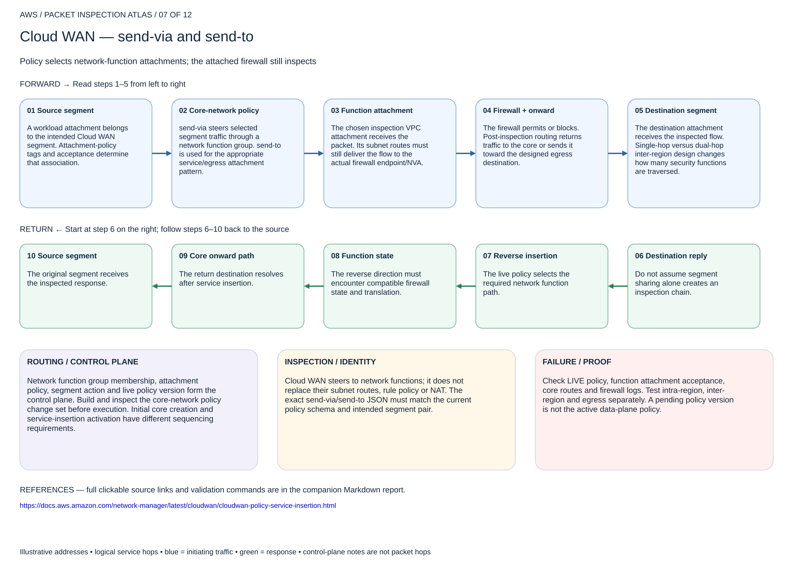

# Cloud WAN — send-via and send-to

## 07. Cloud WAN — send-via and send-to

Policy selects network-function attachments; the attached firewall still inspects

### Forward packet walk

1. **Source segment.** A workload attachment belongs to the intended Cloud WAN segment. Attachment-policy tags and acceptance determine that association.
2. **Core-network policy.** send-via steers selected segment traffic through a network function group. send-to is used for the appropriate service/egress attachment pattern.
3. **Function attachment.** The chosen inspection VPC attachment receives the packet. Its subnet routes must still deliver the flow to the actual firewall endpoint/NVA.
4. **Firewall + onward.** The firewall permits or blocks. Post-inspection routing returns traffic to the core or sends it toward the designed egress destination.
5. **Destination segment.** The destination attachment receives the inspected flow. Single-hop versus dual-hop inter-region design changes how many security functions are traversed.

### Return packet walk

6. **Destination reply.** Do not assume segment sharing alone creates an inspection chain.
7. **Reverse insertion.** The live policy selects the required network function path.
8. **Function state.** The reverse direction must encounter compatible firewall state and translation.
9. **Core onward path.** The return destination resolves after service insertion.
10. **Source segment.** The original segment receives the inspected response.

### Routing and control plane

Network function group membership, attachment policy, segment action and live policy version form the control plane. Build and inspect the core-network policy change set before execution. Initial core creation and service-insertion activation have different sequencing requirements.

### Inspection and identity

Cloud WAN steers to network functions; it does not replace their subnet routes, rule policy or NAT. The exact send-via/send-to JSON must match the current policy schema and intended segment pair.

### Failure and validation

Check LIVE policy, function attachment acceptance, core routes and firewall logs. Test intra-region, inter-region and egress separately. A pending policy version is not the active data-plane policy.

Sources: [Reference 1](https://docs.aws.amazon.com/network-manager/latest/cloudwan/cloudwan-policy-service-insertion.html)

## Terraform lab

[Open this scenario lab](2026-11-04-0203-terraform/cloud-wan-policy/README.md). Applies a complete policy document to an existing dedicated LIVE core network. Sample creates prod and inspection network-function-group policy. Existing accepted VPC/function attachments must carry the sample tags, and inspection-VPC routes/security must already work. The sample replaces the entire policy; never aim it at a shared production core.

Inspect the service-insertion change set and the LIVE policy. Use service-insertion-policy.json for send-via and send-to-policy.json for the separate egress variant. The endpoint/attachment VPC still needs correct post-inspection routes. Validate AWS policy acceptance separately; terraform validate cannot validate embedded Cloud WAN JSON semantics.

[Editable multipage draw.io, page 07](2026-11-04-0203-aws-packet-inspection-atlas.drawio) · [All designs](README.md)
