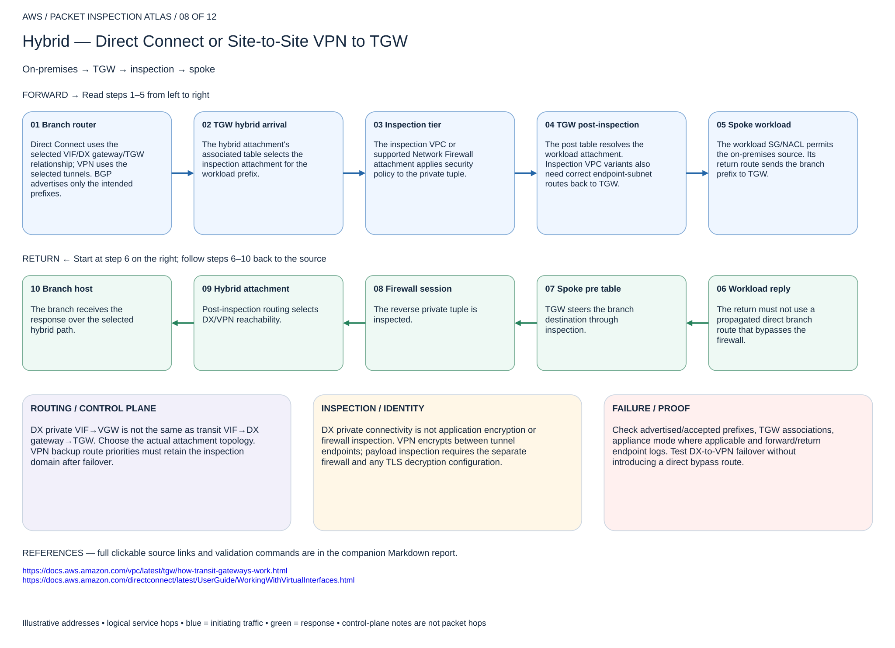

# Hybrid — Direct Connect or Site-to-Site VPN to TGW

## 08. Hybrid — Direct Connect or Site-to-Site VPN to TGW

On-premises → TGW → inspection → spoke

### Forward packet walk

1. **Branch router.** Direct Connect uses the selected VIF/DX gateway/TGW relationship; VPN uses the selected tunnels. BGP advertises only the intended prefixes.
2. **TGW hybrid arrival.** The hybrid attachment's associated table selects the inspection attachment for the workload prefix.
3. **Inspection tier.** The inspection VPC or supported Network Firewall attachment applies security policy to the private tuple.
4. **TGW post-inspection.** The post table resolves the workload attachment. Inspection VPC variants also need correct endpoint-subnet routes back to TGW.
5. **Spoke workload.** The workload SG/NACL permits the on-premises source. Its return route sends the branch prefix to TGW.

### Return packet walk

6. **Workload reply.** The return must not use a propagated direct branch route that bypasses the firewall.
7. **Spoke pre table.** TGW steers the branch destination through inspection.
8. **Firewall session.** The reverse private tuple is inspected.
9. **Hybrid attachment.** Post-inspection routing selects DX/VPN reachability.
10. **Branch host.** The branch receives the response over the selected hybrid path.

### Routing and control plane

DX private VIF→VGW is not the same as transit VIF→DX gateway→TGW. Choose the actual attachment topology. VPN backup route priorities must retain the inspection domain after failover.

### Inspection and identity

DX private connectivity is not application encryption or firewall inspection. VPN encrypts between tunnel endpoints; payload inspection requires the separate firewall and any TLS decryption configuration.

### Failure and validation

Check advertised/accepted prefixes, TGW associations, appliance mode where applicable and forward/return endpoint logs. Test DX-to-VPN failover without introducing a direct bypass route.

Sources: [Reference 1](https://docs.aws.amazon.com/vpc/latest/tgw/how-transit-gateways-work.html) · [Reference 2](https://docs.aws.amazon.com/directconnect/latest/UserGuide/WorkingWithVirtualInterfaces.html)

## Terraform lab

[Open this scenario lab](2026-11-04-0203-terraform/tgw-domains/README.md). Reuse TGW pre/post integration with existing DX gateway or VPN attachment included in source_attachments and its on-premises prefix in destinations. Actual Direct Connect circuits/VIFs, customer gateway, VPN tunnels and BGP are external prerequisites.

Test on-premises→spoke and spoke→on-premises through the inspection logs. Fail the primary hybrid path and prove backup routes still enter the pre table. A direct propagated route in that table is a likely bypass.

[Editable multipage draw.io, page 08](2026-11-04-0203-aws-packet-inspection-atlas.drawio) · [All designs](README.md)
