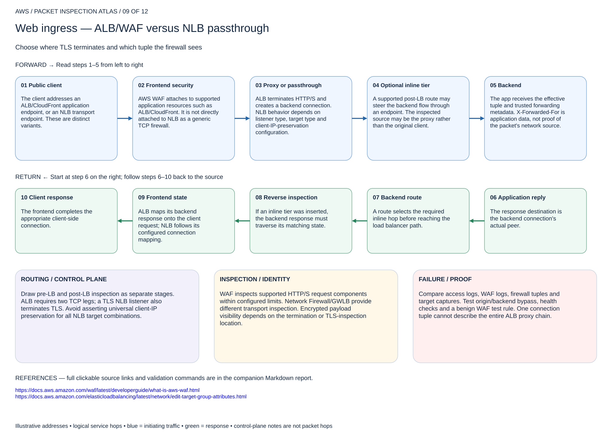

# Web ingress — ALB/WAF versus NLB passthrough

## 09. Web ingress — ALB/WAF versus NLB passthrough

Choose where TLS terminates and which tuple the firewall sees

### Forward packet walk

1. **Public client.** The client addresses an ALB/CloudFront application endpoint, or an NLB transport endpoint. These are distinct variants.
2. **Frontend security.** AWS WAF attaches to supported application resources such as ALB/CloudFront. It is not directly attached to NLB as a generic TCP firewall.
3. **Proxy or passthrough.** ALB terminates HTTP/S and creates a backend connection. NLB behavior depends on listener type, target type and client-IP-preservation configuration.
4. **Optional inline tier.** A supported post-LB route may steer the backend flow through an endpoint. The inspected source may be the proxy rather than the original client.
5. **Backend.** The app receives the effective tuple and trusted forwarding metadata. X-Forwarded-For is application data, not proof of the packet's network source.

### Return packet walk

6. **Application reply.** The response destination is the backend connection's actual peer.
7. **Backend route.** A route selects the required inline hop before reaching the load balancer path.
8. **Reverse inspection.** If an inline tier was inserted, the backend response must traverse its matching state.
9. **Frontend state.** ALB maps its backend response onto the client request; NLB follows its configured connection mapping.
10. **Client response.** The frontend completes the appropriate client-side connection.

### Routing and control plane

Draw pre-LB and post-LB inspection as separate stages. ALB requires two TCP legs; a TLS NLB listener also terminates TLS. Avoid asserting universal client-IP preservation for all NLB target combinations.

### Inspection and identity

WAF inspects supported HTTP/S request components within configured limits. Network Firewall/GWLB provide different transport inspection. Encrypted payload visibility depends on the termination or TLS-inspection location.

### Failure and validation

Compare access logs, WAF logs, firewall tuples and target captures. Test origin/backend bypass, health checks and a benign WAF test rule. One connection tuple cannot describe the entire ALB proxy chain.

Sources: [Reference 1](https://docs.aws.amazon.com/waf/latest/developerguide/what-is-aws-waf.html) · [Reference 2](https://docs.aws.amazon.com/elasticloadbalancing/latest/network/edit-target-group-attributes.html)

## Terraform lab

[Open this scenario lab](2026-11-04-0203-terraform/alb-waf/README.md). Creates and associates a regional WAFv2 ACL with an existing dedicated ALB. Requires healthy ALB listeners/targets and an origin SG that allows only the intended load-balancer path. CloudFront and NLB comparison variants are architectural explanations; this Terraform root implements the ALB/WAF variant.

Send a benign request and a harmless managed-rule test such as an SQL-like query in a test application. Inspect WAF sampled requests and metrics. For optional post-LB inspection use endpoint-routes and prove backend symmetry independently. WAF does not attach directly to NLB.

[Editable multipage draw.io, page 09](2026-11-04-0203-aws-packet-inspection-atlas.drawio) · [All designs](README.md)
