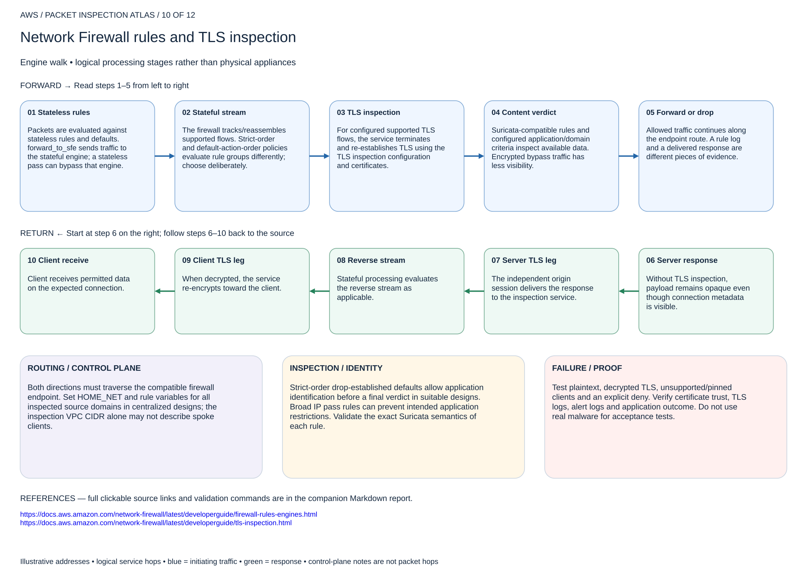

# Network Firewall rules and TLS inspection

## 10. Network Firewall rules and TLS inspection

Engine walk • logical processing stages rather than physical appliances

### Forward packet walk

1. **Stateless rules.** Packets are evaluated against stateless rules and defaults. forward_to_sfe sends traffic to the stateful engine; a stateless pass can bypass that engine.
2. **Stateful stream.** The firewall tracks/reassembles supported flows. Strict-order and default-action-order policies evaluate rule groups differently; choose deliberately.
3. **TLS inspection.** For configured supported TLS flows, the service terminates and re-establishes TLS using the TLS inspection configuration and certificates.
4. **Content verdict.** Suricata-compatible rules and configured application/domain criteria inspect available data. Encrypted bypass traffic has less visibility.
5. **Forward or drop.** Allowed traffic continues along the endpoint route. A rule log and a delivered response are different pieces of evidence.

### Return packet walk

6. **Server response.** Without TLS inspection, payload remains opaque even though connection metadata is visible.
7. **Server TLS leg.** The independent origin session delivers the response to the inspection service.
8. **Reverse stream.** Stateful processing evaluates the reverse stream as applicable.
9. **Client TLS leg.** When decrypted, the service re-encrypts toward the client.
10. **Client receive.** Client receives permitted data on the expected connection.

### Routing and control plane

Both directions must traverse the compatible firewall endpoint. Set HOME_NET and rule variables for all inspected source domains in centralized designs; the inspection VPC CIDR alone may not describe spoke clients.

### Inspection and identity

Strict-order drop-established defaults allow application identification before a final verdict in suitable designs. Broad IP pass rules can prevent intended application restrictions. Validate the exact Suricata semantics of each rule.

### Failure and validation

Test plaintext, decrypted TLS, unsupported/pinned clients and an explicit deny. Verify certificate trust, TLS logs, alert logs and application outcome. Do not use real malware for acceptance tests.

Sources: [Reference 1](https://docs.aws.amazon.com/network-firewall/latest/developerguide/firewall-rules-engines.html) · [Reference 2](https://docs.aws.amazon.com/network-firewall/latest/developerguide/tls-inspection.html)

## Terraform lab

[Open this scenario lab](2026-11-04-0203-terraform/tls-inspection/README.md). Creates outbound Network Firewall TLS configuration using an existing authorized ACM Private CA. Supply source CIDR, then pass output tls_configuration_arn into native-egress and re-plan. Distribute the CA trust to clients; certificate and IAM prerequisites are external.

Inspect the certificate issuer from EC2, test an untrusted/pinned client and correlate TLS/flow/alert evidence. Native-egress has simple transport pass rules; add reviewed narrow application/content rules before claiming an application threat-prevention test. Remove client CA trust during cleanup.

[Editable multipage draw.io, page 10](2026-11-04-0203-aws-packet-inspection-atlas.drawio) · [All designs](README.md)
