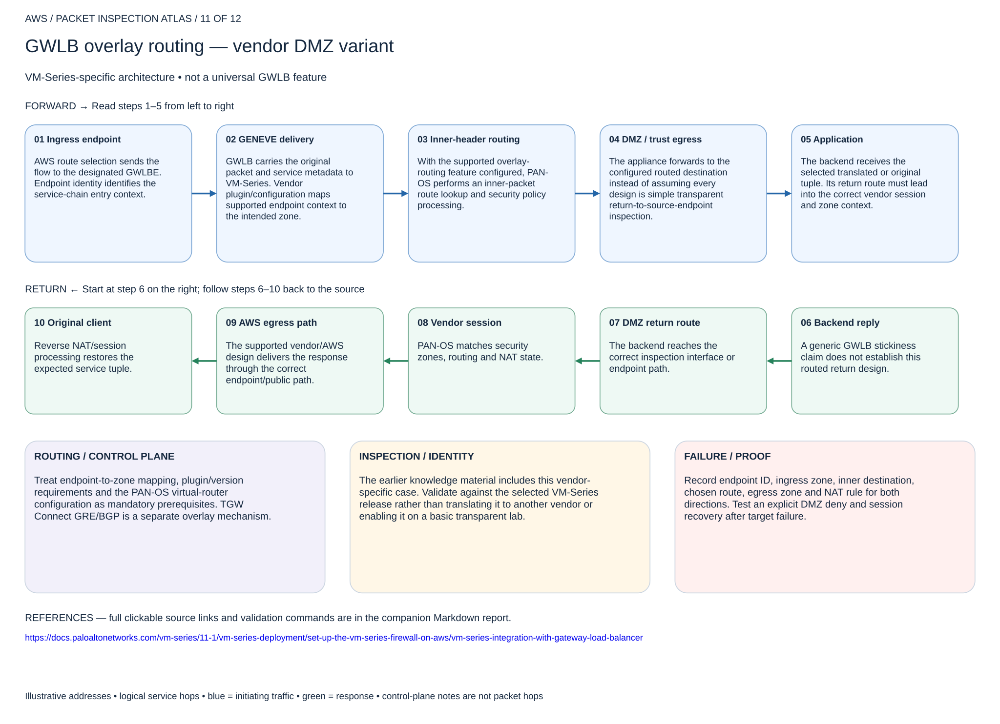

# GWLB overlay routing — vendor DMZ variant

## 11. GWLB overlay routing — vendor DMZ variant

VM-Series-specific architecture • not a universal GWLB feature

### Forward packet walk

1. **Ingress endpoint.** AWS route selection sends the flow to the designated GWLBE. Endpoint identity identifies the service-chain entry context.
2. **GENEVE delivery.** GWLB carries the original packet and service metadata to VM-Series. Vendor plugin/configuration maps supported endpoint context to the intended zone.
3. **Inner-header routing.** With the supported overlay-routing feature configured, PAN-OS performs an inner-packet route lookup and security policy processing.
4. **DMZ / trust egress.** The appliance forwards to the configured routed destination instead of assuming every design is simple transparent return-to-source-endpoint inspection.
5. **Application.** The backend receives the selected translated or original tuple. Its return route must lead into the correct vendor session and zone context.

### Return packet walk

6. **Backend reply.** A generic GWLB stickiness claim does not establish this routed return design.
7. **DMZ return route.** The backend reaches the correct inspection interface or endpoint path.
8. **Vendor session.** PAN-OS matches security zones, routing and NAT state.
9. **AWS egress path.** The supported vendor/AWS design delivers the response through the correct endpoint/public path.
10. **Original client.** Reverse NAT/session processing restores the expected service tuple.

### Routing and control plane

Treat endpoint-to-zone mapping, plugin/version requirements and the PAN-OS virtual-router configuration as mandatory prerequisites. TGW Connect GRE/BGP is a separate overlay mechanism.

### Inspection and identity

The earlier knowledge material includes this vendor-specific case. Validate against the selected VM-Series release rather than translating it to another vendor or enabling it on a basic transparent lab.

### Failure and validation

Record endpoint ID, ingress zone, inner destination, chosen route, egress zone and NAT rule for both directions. Test an explicit DMZ deny and session recovery after target failure.

Sources: [Reference 1](https://docs.paloaltonetworks.com/vm-series/11-1/vm-series-deployment/set-up-the-vm-series-firewall-on-aws/vm-series-integration-with-gateway-load-balancer)

## Terraform lab

[Open this scenario lab](2026-11-04-0203-terraform/gwlb-service/README.md). Reuse the GWLB service primitives and endpoint-routes/nva-routes with a supported VM-Series deployment. Vendor plugin version, endpoint-to-zone mapping, overlay-routing enablement, PAN-OS routes/NAT/security and license are mandatory manual prerequisites. This is not a generic transparent-GWLB toggle.

Follow the linked Palo Alto guide for the selected version. Record endpoint ID, zone, inner destination, selected route, egress zone and NAT rule. Test DMZ inbound/outbound and reverse state. Terraform validates AWS wiring only, not PAN-OS semantics.

[Editable multipage draw.io, page 11](2026-11-04-0203-aws-packet-inspection-atlas.drawio) · [All designs](README.md)
