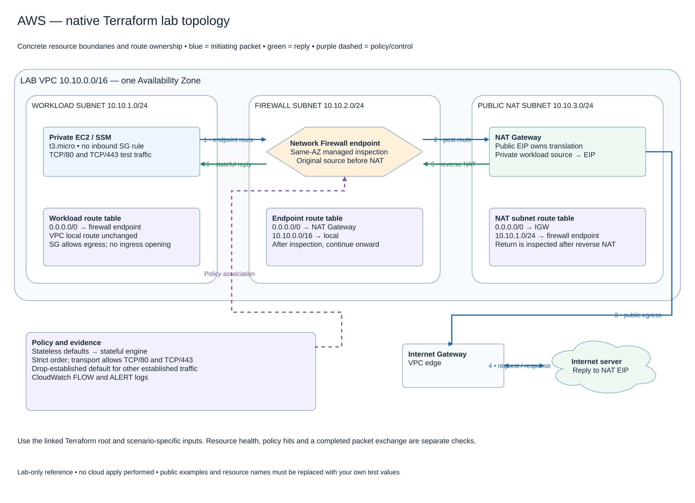

# AWS native Terraform lab topology

This map follows the self-contained native-egress root. It creates one VPC and one Availability Zone, with separate workload, firewall and NAT subnets. That separation allows the packet to follow a different route after inspection. The firewall endpoint does not perform Internet NAT; the NAT Gateway owns that mapping.

A response arrives at the NAT EIP, is reverse-translated, and then matches the more-specific workload-subnet route back to the firewall. Without that route, the VPC local route would bypass inspection. The endpoint subnet local route delivers the already-inspected response to the instance.

The instance has no inbound security-group opening and is accessed through Systems Manager. The initial firewall policy allows TCP/80 and TCP/443, including SSM connectivity, but is not a domain allowlist or a full content-security policy. TLS inspection is a separately configured lab option. This single-AZ topology cannot demonstrate AZ resilience; add a complete parallel zonal path for that test.

## Terraform, tests and cleanup

[Open the native lab](2026-11-04-0203-terraform/native-egress/README.md) for inputs, init/plan/apply, expected charges, acceptance tests and destroy. Read the scenario-specific prerequisites before using it.

[Editable multipage draw.io, page 12](2026-11-04-0203-aws-packet-inspection-atlas.drawio) · [All designs](README.md)
