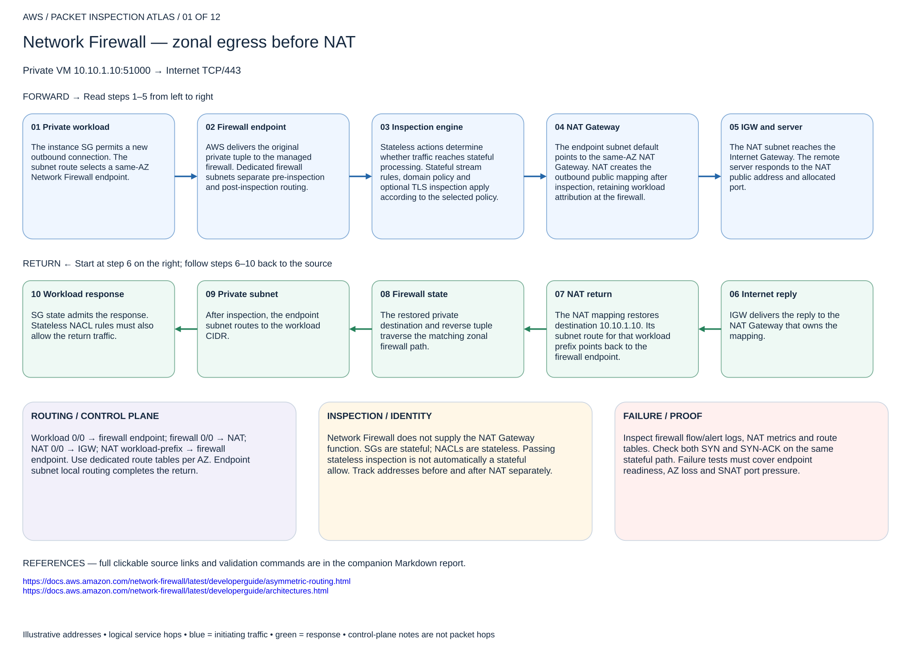
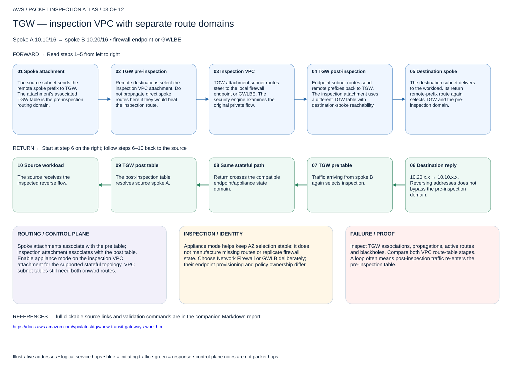
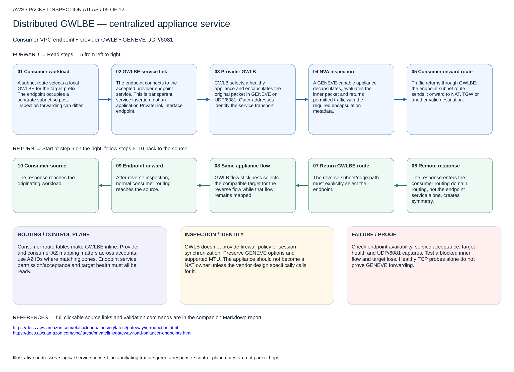
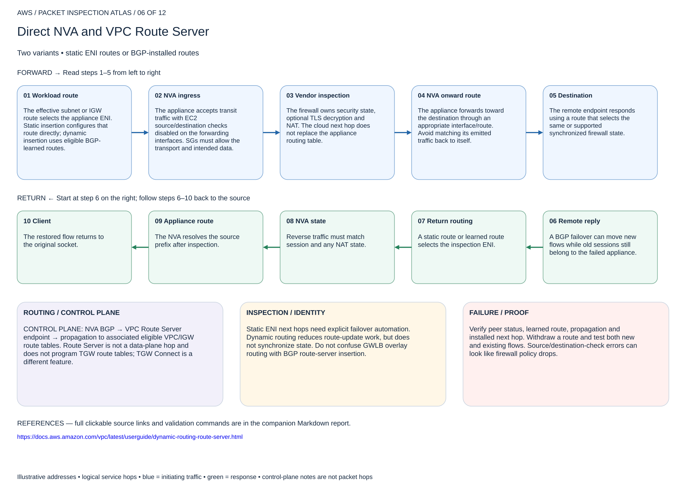
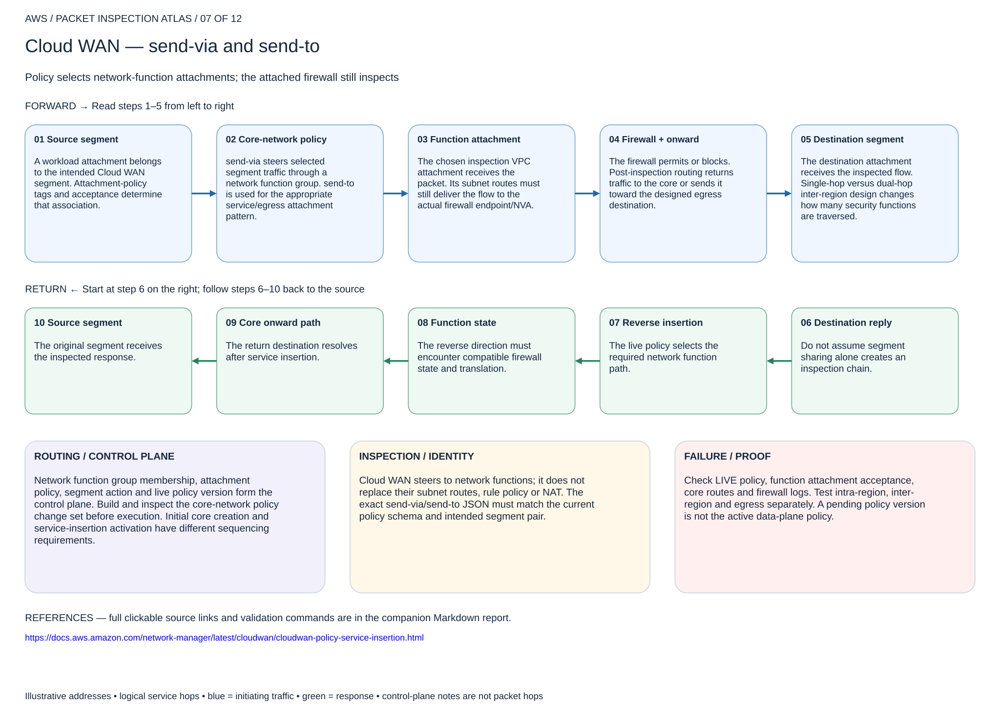
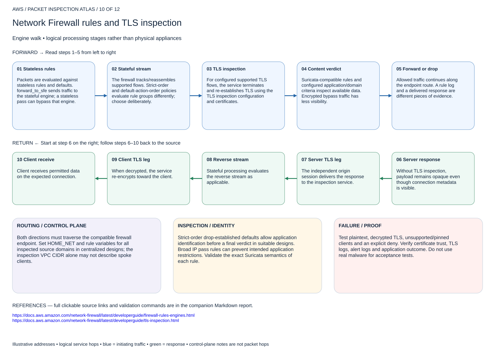
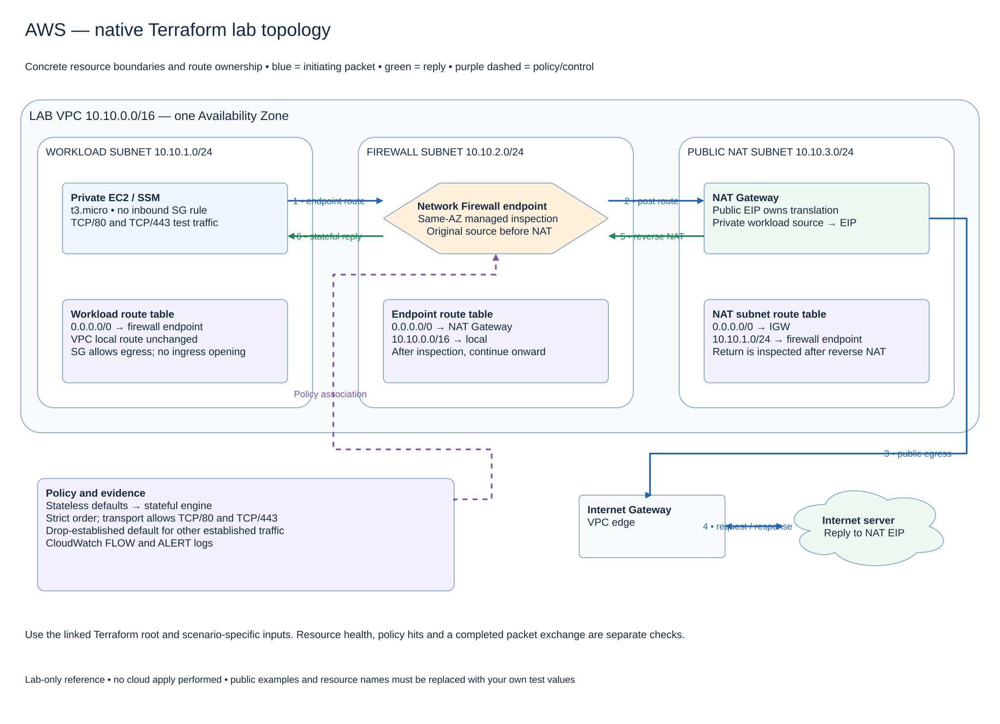

# AWS packet inspection atlas

Start with the numbered page that matches the forwarding design. Blue arrows show the initiating direction; green arrows show the response from right to left. These are logical packet walks, so a repeated cloud router represents another forwarding decision, not another physical router.

All IP addresses are illustrative. Public examples use documentation ranges. This is a design and validation reference, not evidence of a deployed environment. Commands are read-only unless explicitly marked otherwise. No infrastructure was changed.

[Open the editable multipage draw.io atlas](2026-11-04-0203-aws-packet-inspection-atlas.drawio)

## Page index

1. [Network Firewall — zonal egress before NAT](#page-01)
2. [Network Firewall — public ingress and edge routes](#page-02)
3. [TGW — inspection VPC with separate route domains](#page-03)
4. [TGW-attached Network Firewall — managed attachment](#page-04)
5. [Distributed GWLBE — centralized appliance service](#page-05)
6. [Direct NVA and VPC Route Server](#page-06)
7. [Cloud WAN — send-via and send-to](#page-07)
8. [Hybrid — Direct Connect or Site-to-Site VPN to TGW](#page-08)
9. [Web ingress — ALB/WAF versus NLB passthrough](#page-09)
10. [Network Firewall rules and TLS inspection](#page-10)
11. [GWLB overlay routing — vendor DMZ variant](#page-11)

## 01. Network Firewall — zonal egress before NAT

Private VM 10.10.1.10:51000 → Internet TCP/443

### Forward packet walk

1. **Private workload.** The instance SG permits a new outbound connection. The subnet route selects a same-AZ Network Firewall endpoint.
2. **Firewall endpoint.** AWS delivers the original private tuple to the managed firewall. Dedicated firewall subnets separate pre-inspection and post-inspection routing.
3. **Inspection engine.** Stateless actions determine whether traffic reaches stateful processing. Stateful stream rules, domain policy and optional TLS inspection apply according to the selected policy.
4. **NAT Gateway.** The endpoint subnet default points to the same-AZ NAT Gateway. NAT creates the outbound public mapping after inspection, retaining workload attribution at the firewall.
5. **IGW and server.** The NAT subnet reaches the Internet Gateway. The remote server responds to the NAT public address and allocated port.

### Return packet walk

6. **Internet reply.** IGW delivers the reply to the NAT Gateway that owns the mapping.
7. **NAT return.** The NAT mapping restores destination 10.10.1.10. Its subnet route for that workload prefix points back to the firewall endpoint.
8. **Firewall state.** The restored private destination and reverse tuple traverse the matching zonal firewall path.
9. **Private subnet.** After inspection, the endpoint subnet routes to the workload CIDR.
10. **Workload response.** SG state admits the response. Stateless NACL rules must also allow the return traffic.

### Routing and control plane

Workload 0/0 → firewall endpoint; firewall 0/0 → NAT; NAT 0/0 → IGW; NAT workload-prefix → firewall endpoint. Use dedicated route tables per AZ. Endpoint subnet local routing completes the return.

### Inspection and identity

Network Firewall does not supply the NAT Gateway function. SGs are stateful; NACLs are stateless. Passing stateless inspection is not automatically a stateful allow. Track addresses before and after NAT separately.

### Failure and validation

Inspect firewall flow/alert logs, NAT metrics and route tables. Check both SYN and SYN-ACK on the same stateful path. Failure tests must cover endpoint readiness, AZ loss and SNAT port pressure.

Sources: [Reference 1](https://docs.aws.amazon.com/network-firewall/latest/developerguide/asymmetric-routing.html) · [Reference 2](https://docs.aws.amazon.com/network-firewall/latest/developerguide/architectures.html)

## 02. Network Firewall — public ingress and edge routes

Internet → IGW edge route → firewall endpoint → public application

### Forward packet walk

1. **Internet request.** The client targets the application's public address. IGW address mapping and edge-associated routing bring the flow into the VPC.
2. **IGW route table.** The ingress route for the application subnet targets the firewall endpoint. This edge association is separate from the application subnet route table.
3. **Managed inspection.** The firewall sees the packet on the selected zonal endpoint and applies its rule policy. TLS payload remains encrypted unless supported decryption is configured.
4. **Application subnet.** The firewall subnet resolves the destination through VPC routing. The workload SG and NACL must permit the effective client tuple.
5. **Application.** The backend responds toward the Internet client. Its default route sends the reply to the firewall endpoint, not directly to the IGW.

### Return packet walk

6. **Application reply.** A directly attached public IP does not remove the need for the reverse route.
7. **Application default.** 0/0 → firewall endpoint forces the response back through inspection.
8. **Firewall reverse.** The reverse connection crosses the same stateful inspection path.
9. **IGW egress.** Post-inspection traffic leaves through the IGW and applicable public mapping.
10. **Internet client.** The reply reaches the public service tuple the client contacted.

### Routing and control plane

Create an IGW edge-associated route table with a valid application-prefix endpoint route. Keep the firewall subnet's onward Internet route distinct from the workload subnet default. This page is a direct public-workload example; ALB proxying changes tuples.

### Inspection and identity

Limit ingress policy and workload SG to the intended source/service. A packet can be allowed by Network Firewall and still be dropped by SG/NACL. Content visibility depends on TLS termination placement.

### Failure and validation

Test allowed and denied source/port pairs. Verify the edge association exists and that the return does not bypass inspection. Do not expose an administrative port just to prove reachability.

Sources: [Reference 1](https://docs.aws.amazon.com/network-firewall/latest/developerguide/vpc-config-route-tables.html)

## 03. TGW — inspection VPC with separate route domains

Spoke A 10.10/16 → spoke B 10.20/16 • firewall endpoint or GWLBE

### Forward packet walk

1. **Spoke attachment.** The source subnet sends the remote spoke prefix to TGW. The attachment's associated TGW table is the pre-inspection routing domain.
2. **TGW pre-inspection.** Remote destinations select the inspection VPC attachment. Do not propagate direct spoke routes here if they would beat the inspection route.
3. **Inspection VPC.** TGW attachment subnet routes steer to the local firewall endpoint or GWLBE. The security engine examines the original private flow.
4. **TGW post-inspection.** Endpoint subnet routes send remote prefixes back to TGW. The inspection attachment uses a different TGW table with destination-spoke reachability.
5. **Destination spoke.** The destination subnet delivers to the workload. Its return remote-prefix route again selects TGW and the pre-inspection domain.

### Return packet walk

6. **Destination reply.** 10.20.x.x → 10.10.x.x. Reversing addresses does not bypass the pre-inspection domain.
7. **TGW pre table.** Traffic arriving from spoke B again selects inspection.
8. **Same stateful path.** Return crosses the compatible endpoint/appliance state domain.
9. **TGW post table.** The post-inspection table resolves source spoke A.
10. **Source workload.** The source receives the inspected reverse flow.

### Routing and control plane

Spoke attachments associate with the pre table; inspection attachment associates with the post table. Enable appliance mode on the inspection VPC attachment for the supported stateful topology. VPC subnet tables still need both onward routes.

### Inspection and identity

Appliance mode helps keep AZ selection stable; it does not manufacture missing routes or replicate firewall state. Choose Network Firewall or GWLB deliberately; their endpoint provisioning and policy ownership differ.

### Failure and validation

Inspect TGW associations, propagations, active routes and blackholes. Compare both VPC route-table stages. A loop often means post-inspection traffic re-enters the pre-inspection table.

Sources: [Reference 1](https://docs.aws.amazon.com/vpc/latest/tgw/how-transit-gateways-work.html)

## 04. TGW-attached Network Firewall — managed attachment

Native network-function attachment • different from an inspection VPC

### Forward packet walk

1. **Source attachment.** The spoke forwards toward TGW. The associated route table determines whether this flow is inspected.
2. **TGW steering.** A route selects the Network Firewall network-function attachment instead of a customer inspection VPC attachment.
3. **Managed firewall.** AWS provisions the integrated inspection path and applies the firewall policy. The customer does not build the traditional endpoint-subnet plumbing for this attachment.
4. **Post-inspection domain.** The firewall attachment's TGW route-table association must resolve the final destination without re-entering the same inspection path.
5. **Destination.** The remote attachment forwards to its workload. The response must also be steered through the managed firewall attachment.

### Return packet walk

6. **Remote reply.** The same insertion policy must hold for the return traffic class.
7. **Destination TGW table.** The response route selects the firewall attachment.
8. **Firewall state.** The managed service inspects the reverse flow.
9. **Post-inspection lookup.** The associated table provides a source route.
10. **Source attachment.** TGW resolves the original source after inspection.

### Routing and control plane

Keep pre-inspection and post-inspection route roles explicit. Read the service's current regional, account-sharing and attachment constraints. This is not the same resource model as firewall endpoints in your own VPC.

### Inspection and identity

Firewall ownership and TGW ownership can differ through supported sharing. Policy remains managed by the firewall owner. Reachability is not evidence that the TGW route chose the network-function attachment.

### Failure and validation

Inspect the attachment state, TGW associated tables and firewall logs. Test a denied flow and route withdrawal. Do not apply VPC appliance-mode instructions mechanically to a different attachment type.

Sources: [Reference 1](https://docs.aws.amazon.com/network-firewall/latest/developerguide/tgw-firewall.html)

## 05. Distributed GWLBE — centralized appliance service

Consumer VPC endpoint • provider GWLB • GENEVE UDP/6081

### Forward packet walk

1. **Consumer workload.** A subnet route selects a local GWLBE for the target prefix. The endpoint occupies a separate subnet so post-inspection forwarding can differ.
2. **GWLBE service link.** The endpoint connects to the accepted provider endpoint service. This is transparent service insertion, not an application PrivateLink interface endpoint.
3. **Provider GWLB.** GWLB selects a healthy appliance and encapsulates the original packet in GENEVE on UDP/6081. Outer addresses identify the service transport.
4. **NVA inspection.** A GENEVE-capable appliance decapsulates, evaluates the inner packet and returns permitted traffic with the required encapsulation metadata.
5. **Consumer onward route.** Traffic returns through GWLBE; the endpoint subnet route sends it onward to NAT, TGW or another valid destination.

### Return packet walk

6. **Remote response.** The response enters the consumer routing domain; routing, not the endpoint service alone, creates symmetry.
7. **Return GWLBE route.** The reverse subnet/edge path must explicitly select the endpoint.
8. **Same appliance flow.** GWLB flow stickiness selects the compatible target for the reverse flow while that flow remains mapped.
9. **Endpoint onward.** After reverse inspection, normal consumer routing reaches the source.
10. **Consumer source.** The response reaches the originating workload.

### Routing and control plane

Consumer route tables make GWLBE inline. Provider and consumer AZ mapping matters across accounts; use AZ IDs where matching zones. Endpoint service permission/acceptance and target health must all be ready.

### Inspection and identity

GWLB does not provide firewall policy or session synchronization. Preserve GENEVE options and supported MTU. The appliance should not become a NAT owner unless the vendor design specifically calls for it.

### Failure and validation

Check endpoint availability, service acceptance, target health and UDP/6081 captures. Test a blocked inner flow and target loss. Healthy TCP probes alone do not prove GENEVE forwarding.

Sources: [Reference 1](https://docs.aws.amazon.com/elasticloadbalancing/latest/gateway/introduction.html) · [Reference 2](https://docs.aws.amazon.com/vpc/latest/privatelink/gateway-load-balancer-endpoints.html)

## 06. Direct NVA and VPC Route Server

Two variants • static ENI routes or BGP-installed routes

### Forward packet walk

1. **Workload route.** The effective subnet or IGW route selects the appliance ENI. Static insertion configures that route directly; dynamic insertion uses eligible BGP-learned routes.
2. **NVA ingress.** The appliance accepts transit traffic with EC2 source/destination checks disabled on the forwarding interfaces. SGs must allow the transport and intended data.
3. **Vendor inspection.** The firewall owns security state, optional TLS decryption and NAT. The cloud next hop does not replace the appliance routing table.
4. **NVA onward route.** The appliance forwards toward the destination through an appropriate interface/route. Avoid matching its emitted traffic back to itself.
5. **Destination.** The remote endpoint responds using a route that selects the same or supported synchronized firewall state.

### Return packet walk

6. **Remote reply.** A BGP failover can move new flows while old sessions still belong to the failed appliance.
7. **Return routing.** A static route or learned route selects the inspection ENI.
8. **NVA state.** Reverse traffic must match session and any NAT state.
9. **Appliance route.** The NVA resolves the source prefix after inspection.
10. **Client.** The restored flow returns to the original socket.

### Routing and control plane

CONTROL PLANE: NVA BGP → VPC Route Server endpoint → propagation to associated eligible VPC/IGW route tables. Route Server is not a data-plane hop and does not program TGW route tables; TGW Connect is a different feature.

### Inspection and identity

Static ENI next hops need explicit failover automation. Dynamic routing reduces route-update work, but does not synchronize state. Do not confuse GWLB overlay routing with BGP route-server insertion.

### Failure and validation

Verify peer status, learned route, propagation and installed next hop. Withdraw a route and test both new and existing flows. Source/destination-check errors can look like firewall policy drops.

Sources: [Reference 1](https://docs.aws.amazon.com/vpc/latest/userguide/dynamic-routing-route-server.html)

## 07. Cloud WAN — send-via and send-to

Policy selects network-function attachments; the attached firewall still inspects

### Forward packet walk

1. **Source segment.** A workload attachment belongs to the intended Cloud WAN segment. Attachment-policy tags and acceptance determine that association.
2. **Core-network policy.** send-via steers selected segment traffic through a network function group. send-to is used for the appropriate service/egress attachment pattern.
3. **Function attachment.** The chosen inspection VPC attachment receives the packet. Its subnet routes must still deliver the flow to the actual firewall endpoint/NVA.
4. **Firewall + onward.** The firewall permits or blocks. Post-inspection routing returns traffic to the core or sends it toward the designed egress destination.
5. **Destination segment.** The destination attachment receives the inspected flow. Single-hop versus dual-hop inter-region design changes how many security functions are traversed.

### Return packet walk

6. **Destination reply.** Do not assume segment sharing alone creates an inspection chain.
7. **Reverse insertion.** The live policy selects the required network function path.
8. **Function state.** The reverse direction must encounter compatible firewall state and translation.
9. **Core onward path.** The return destination resolves after service insertion.
10. **Source segment.** The original segment receives the inspected response.

### Routing and control plane

Network function group membership, attachment policy, segment action and live policy version form the control plane. Build and inspect the core-network policy change set before execution. Initial core creation and service-insertion activation have different sequencing requirements.

### Inspection and identity

Cloud WAN steers to network functions; it does not replace their subnet routes, rule policy or NAT. The exact send-via/send-to JSON must match the current policy schema and intended segment pair.

### Failure and validation

Check LIVE policy, function attachment acceptance, core routes and firewall logs. Test intra-region, inter-region and egress separately. A pending policy version is not the active data-plane policy.

Sources: [Reference 1](https://docs.aws.amazon.com/network-manager/latest/cloudwan/cloudwan-policy-service-insertion.html)

## 08. Hybrid — Direct Connect or Site-to-Site VPN to TGW

On-premises → TGW → inspection → spoke

### Forward packet walk

1. **Branch router.** Direct Connect uses the selected VIF/DX gateway/TGW relationship; VPN uses the selected tunnels. BGP advertises only the intended prefixes.
2. **TGW hybrid arrival.** The hybrid attachment's associated table selects the inspection attachment for the workload prefix.
3. **Inspection tier.** The inspection VPC or supported Network Firewall attachment applies security policy to the private tuple.
4. **TGW post-inspection.** The post table resolves the workload attachment. Inspection VPC variants also need correct endpoint-subnet routes back to TGW.
5. **Spoke workload.** The workload SG/NACL permits the on-premises source. Its return route sends the branch prefix to TGW.

### Return packet walk

6. **Workload reply.** The return must not use a propagated direct branch route that bypasses the firewall.
7. **Spoke pre table.** TGW steers the branch destination through inspection.
8. **Firewall session.** The reverse private tuple is inspected.
9. **Hybrid attachment.** Post-inspection routing selects DX/VPN reachability.
10. **Branch host.** The branch receives the response over the selected hybrid path.

### Routing and control plane

DX private VIF→VGW is not the same as transit VIF→DX gateway→TGW. Choose the actual attachment topology. VPN backup route priorities must retain the inspection domain after failover.

### Inspection and identity

DX private connectivity is not application encryption or firewall inspection. VPN encrypts between tunnel endpoints; payload inspection requires the separate firewall and any TLS decryption configuration.

### Failure and validation

Check advertised/accepted prefixes, TGW associations, appliance mode where applicable and forward/return endpoint logs. Test DX-to-VPN failover without introducing a direct bypass route.

Sources: [Reference 1](https://docs.aws.amazon.com/vpc/latest/tgw/how-transit-gateways-work.html) · [Reference 2](https://docs.aws.amazon.com/directconnect/latest/UserGuide/WorkingWithVirtualInterfaces.html)

## 09. Web ingress — ALB/WAF versus NLB passthrough

Choose where TLS terminates and which tuple the firewall sees

### Forward packet walk

1. **Public client.** The client addresses an ALB/CloudFront application endpoint, or an NLB transport endpoint. These are distinct variants.
2. **Frontend security.** AWS WAF attaches to supported application resources such as ALB/CloudFront. It is not directly attached to NLB as a generic TCP firewall.
3. **Proxy or passthrough.** ALB terminates HTTP/S and creates a backend connection. NLB behavior depends on listener type, target type and client-IP-preservation configuration.
4. **Optional inline tier.** A supported post-LB route may steer the backend flow through an endpoint. The inspected source may be the proxy rather than the original client.
5. **Backend.** The app receives the effective tuple and trusted forwarding metadata. X-Forwarded-For is application data, not proof of the packet's network source.

### Return packet walk

6. **Application reply.** The response destination is the backend connection's actual peer.
7. **Backend route.** A route selects the required inline hop before reaching the load balancer path.
8. **Reverse inspection.** If an inline tier was inserted, the backend response must traverse its matching state.
9. **Frontend state.** ALB maps its backend response onto the client request; NLB follows its configured connection mapping.
10. **Client response.** The frontend completes the appropriate client-side connection.

### Routing and control plane

Draw pre-LB and post-LB inspection as separate stages. ALB requires two TCP legs; a TLS NLB listener also terminates TLS. Avoid asserting universal client-IP preservation for all NLB target combinations.

### Inspection and identity

WAF inspects supported HTTP/S request components within configured limits. Network Firewall/GWLB provide different transport inspection. Encrypted payload visibility depends on the termination or TLS-inspection location.

### Failure and validation

Compare access logs, WAF logs, firewall tuples and target captures. Test origin/backend bypass, health checks and a benign WAF test rule. One connection tuple cannot describe the entire ALB proxy chain.

Sources: [Reference 1](https://docs.aws.amazon.com/waf/latest/developerguide/what-is-aws-waf.html) · [Reference 2](https://docs.aws.amazon.com/elasticloadbalancing/latest/network/edit-target-group-attributes.html)

## 10. Network Firewall rules and TLS inspection

Engine walk • logical processing stages rather than physical appliances

### Forward packet walk

1. **Stateless rules.** Packets are evaluated against stateless rules and defaults. forward_to_sfe sends traffic to the stateful engine; a stateless pass can bypass that engine.
2. **Stateful stream.** The firewall tracks/reassembles supported flows. Strict-order and default-action-order policies evaluate rule groups differently; choose deliberately.
3. **TLS inspection.** For configured supported TLS flows, the service terminates and re-establishes TLS using the TLS inspection configuration and certificates.
4. **Content verdict.** Suricata-compatible rules and configured application/domain criteria inspect available data. Encrypted bypass traffic has less visibility.
5. **Forward or drop.** Allowed traffic continues along the endpoint route. A rule log and a delivered response are different pieces of evidence.

### Return packet walk

6. **Server response.** Without TLS inspection, payload remains opaque even though connection metadata is visible.
7. **Server TLS leg.** The independent origin session delivers the response to the inspection service.
8. **Reverse stream.** Stateful processing evaluates the reverse stream as applicable.
9. **Client TLS leg.** When decrypted, the service re-encrypts toward the client.
10. **Client receive.** Client receives permitted data on the expected connection.

### Routing and control plane

Both directions must traverse the compatible firewall endpoint. Set HOME_NET and rule variables for all inspected source domains in centralized designs; the inspection VPC CIDR alone may not describe spoke clients.

### Inspection and identity

Strict-order drop-established defaults allow application identification before a final verdict in suitable designs. Broad IP pass rules can prevent intended application restrictions. Validate the exact Suricata semantics of each rule.

### Failure and validation

Test plaintext, decrypted TLS, unsupported/pinned clients and an explicit deny. Verify certificate trust, TLS logs, alert logs and application outcome. Do not use real malware for acceptance tests.

Sources: [Reference 1](https://docs.aws.amazon.com/network-firewall/latest/developerguide/firewall-rules-engines.html) · [Reference 2](https://docs.aws.amazon.com/network-firewall/latest/developerguide/tls-inspection.html)

## 11. GWLB overlay routing — vendor DMZ variant

VM-Series-specific architecture • not a universal GWLB feature

### Forward packet walk

1. **Ingress endpoint.** AWS route selection sends the flow to the designated GWLBE. Endpoint identity identifies the service-chain entry context.
2. **GENEVE delivery.** GWLB carries the original packet and service metadata to VM-Series. Vendor plugin/configuration maps supported endpoint context to the intended zone.
3. **Inner-header routing.** With the supported overlay-routing feature configured, PAN-OS performs an inner-packet route lookup and security policy processing.
4. **DMZ / trust egress.** The appliance forwards to the configured routed destination instead of assuming every design is simple transparent return-to-source-endpoint inspection.
5. **Application.** The backend receives the selected translated or original tuple. Its return route must lead into the correct vendor session and zone context.

### Return packet walk

6. **Backend reply.** A generic GWLB stickiness claim does not establish this routed return design.
7. **DMZ return route.** The backend reaches the correct inspection interface or endpoint path.
8. **Vendor session.** PAN-OS matches security zones, routing and NAT state.
9. **AWS egress path.** The supported vendor/AWS design delivers the response through the correct endpoint/public path.
10. **Original client.** Reverse NAT/session processing restores the expected service tuple.

### Routing and control plane

Treat endpoint-to-zone mapping, plugin/version requirements and the PAN-OS virtual-router configuration as mandatory prerequisites. TGW Connect GRE/BGP is a separate overlay mechanism.

### Inspection and identity

The earlier knowledge material includes this vendor-specific case. Validate against the selected VM-Series release rather than translating it to another vendor or enabling it on a basic transparent lab.

### Failure and validation

Record endpoint ID, ingress zone, inner destination, chosen route, egress zone and NAT rule for both directions. Test an explicit DMZ deny and session recovery after target failure.

Sources: [Reference 1](https://docs.paloaltonetworks.com/vm-series/11-1/vm-series-deployment/set-up-the-vm-series-firewall-on-aws/vm-series-integration-with-gateway-load-balancer)

## Evidence and scope

This atlas develops the existing [AWS insertion summary](https://github.com/ccaiccie/knowledge/blob/main/09-07-26_AWS_Firewall_Insertion_Summary.md) and its linked deep dives. Original repository drawings were inspected for the established architecture vocabulary; these new pages expand the packet walks and distinguish service boundaries. Official references were reviewed on 2026-11-04. Source guides describe patterns, not a verified live deployment.

## Validation procedure

For each page, record the client five-tuple, DNS answer, winning forward route, rule hit, translation mapping, post-inspection route, winning return route and observed response. Use a fresh allowed connection and a fresh denied connection. Repeat after a controlled HA failure in a non-production test environment. A healthy endpoint or successful ping alone is not proof of inspection.

Rollback for a future implementation must restore the previous routing/policy associations and translation design together. Export those objects before making a change, preserve a management path, and expect existing stateful sessions to reset. The linked Terraform labs provide isolated test deployment and destroy workflows; they were not applied.

## Concrete native lab topology

[Resource map and explanation](2026-11-04-0203-aws-12-native-terraform-lab-topology.md)

